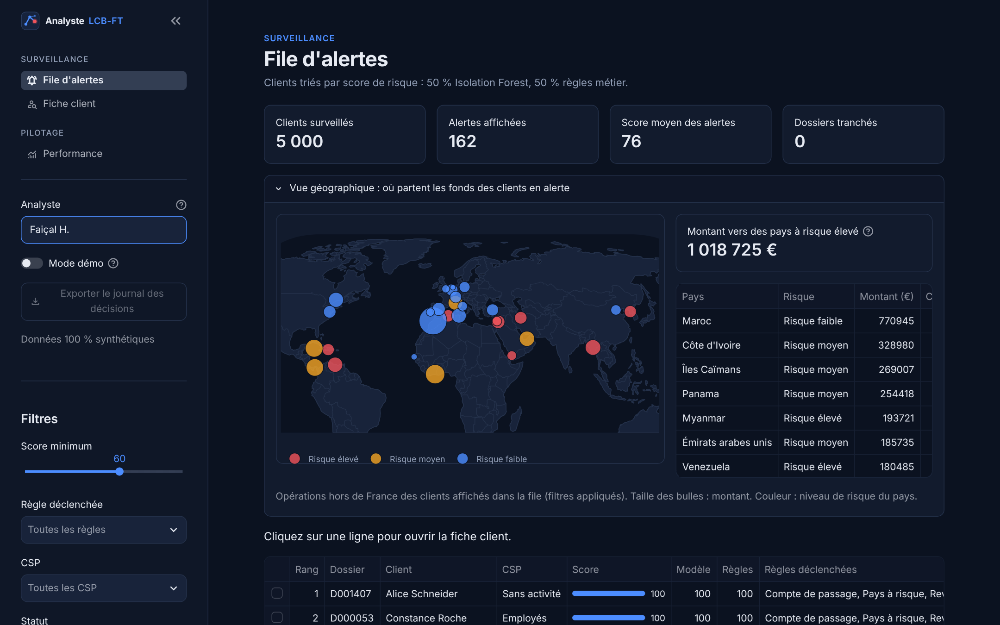
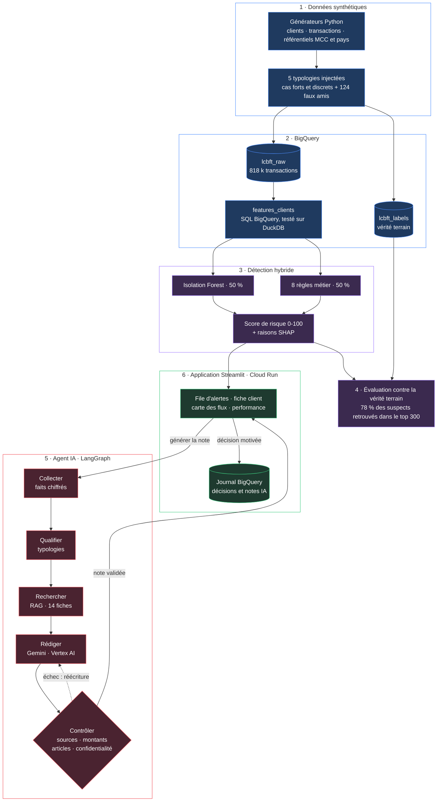
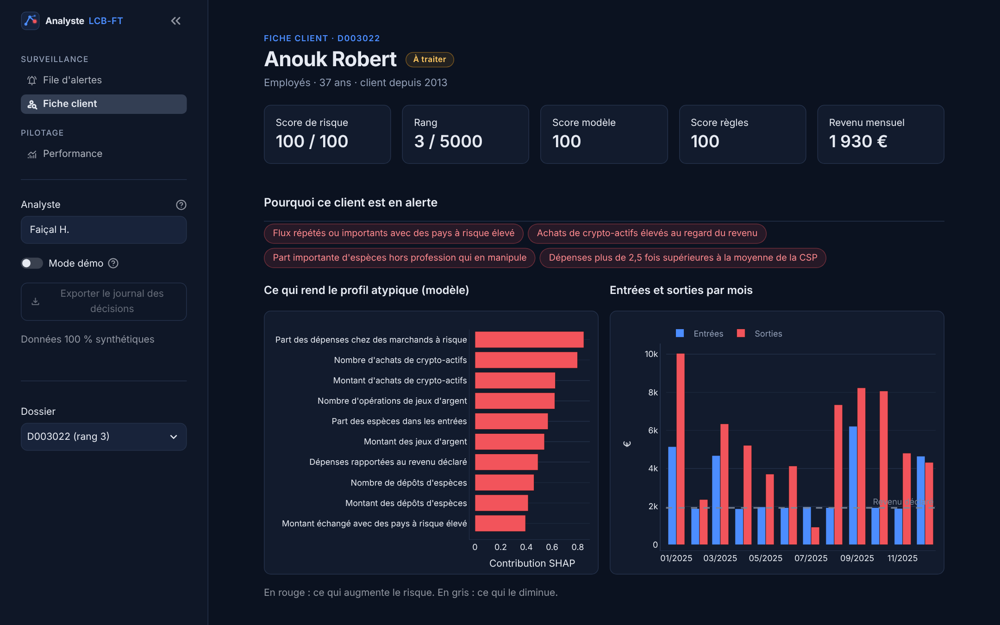
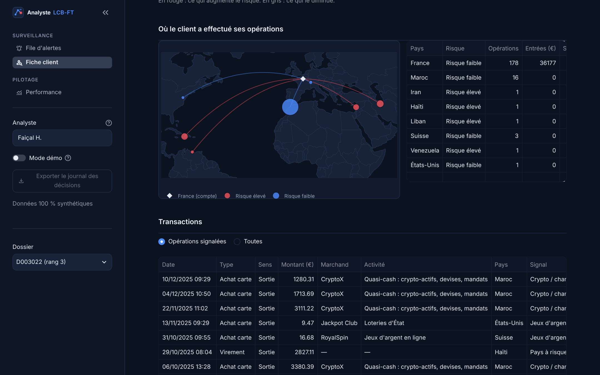
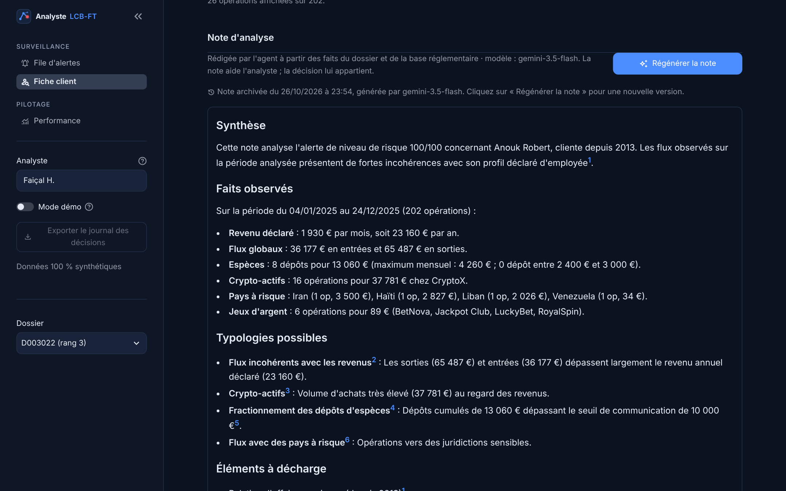
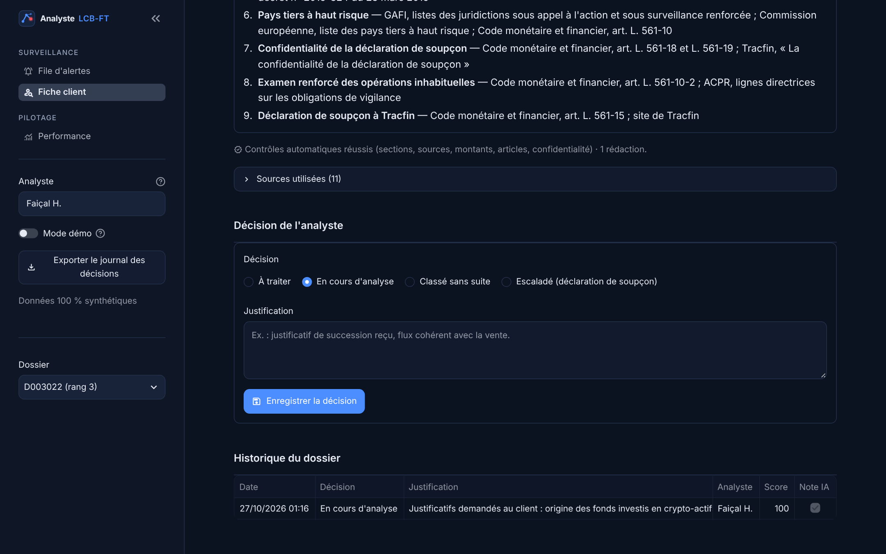
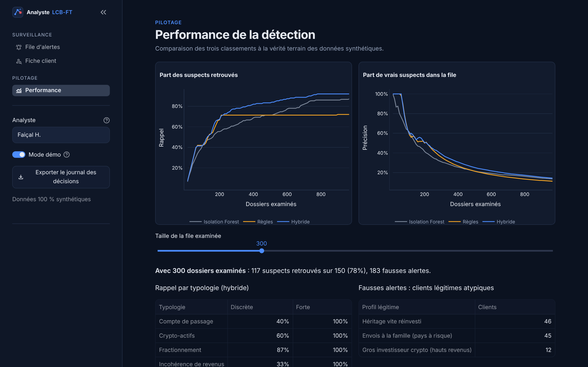

# lcbft-assistant

Assistant de détection LCB-FT (lutte contre le blanchiment et le financement du terrorisme). Il repère les clients au comportement suspect et prépare une note d'analyse pour l'analyste conformité.

Toutes les données du projet sont synthétiques. Aucune donnée réelle de client ou de banque n'est utilisée.



## Vue d'ensemble



## Aperçu de l'application

| | |
|---|---|
|  |  |
| **Fiche client** : score, règles déclenchées, explications SHAP et flux mensuels comparés au revenu déclaré. | **Carte des flux** : pays où le client opère, colorés selon leur niveau de risque. |
|  |  |
| **Note d'analyse** rédigée par Gemini, avec renvois numérotés vers les textes de référence. Ici, une note réelle archivée, validée par les contrôles du premier coup. | **Décision de l'analyste** : chaque décision motivée est ajoutée au journal BigQuery, jamais écrasée. |



*Page Performance (mode démo) : rappel et précision des trois méthodes selon le nombre de dossiers examinés, rappel par typologie et origine des fausses alertes.*

## Le problème

Dans une banque de détail, les dispositifs LCB-FT reposent souvent sur des règles fixes et des seuils statiques. Ils produisent beaucoup d'alertes, dont une grande partie de faux positifs, et l'analyste passe plus de 30 minutes sur chaque dossier pour comprendre pourquoi un client a été remonté.

Le projet vise deux choses : mieux classer les alertes pour que les cas vraiment suspects arrivent en tête, et réduire le temps d'analyse avec une note préparée par un agent IA qui cite la réglementation.

## Utilisateur cible

Un analyste conformité qui traite une file d'alertes chaque jour et doit justifier chaque décision (classement sans suite ou escalade vers une déclaration de soupçon).

## Typologies couvertes

Le générateur injecte cinq comportements suspects dans les données :

1. Fractionnement : plusieurs dépôts en espèces juste sous un seuil.
2. Compte de passage : une grosse entrée suivie d'une sortie quasi identique en moins de 48h.
3. Flux vers des pays à risque, d'après la liste publique du GAFI.
4. Incohérence revenus/dépenses : des flux très supérieurs au revenu déclaré et au niveau habituel de la catégorie socio-professionnelle.
5. Crypto-actifs : des achats répétés ou élevés auprès de plateformes crypto, sans rapport avec le revenu déclaré, souvent alimentés par des espèces ou combinés à des flux vers des pays à risque.

Acheter de la crypto n'est pas suspect en soi. Beaucoup de clients en achètent un peu. C'est la combinaison montant élevé, profil incohérent et origine des fonds qui doit déclencher l'alerte.

## Approche

Le projet suit six étapes.

1. Données : génération de tables brutes (clients, transactions, référentiels pays, MCC et marchands), puis construction d'une table de features client en SQL.
2. Détection : un Isolation Forest repère les profils atypiques et des règles métier encodent les typologies connues. Le score final combine les deux à parts égales. SHAP explique la contribution de chaque variable.
3. Évaluation : comme les typologies sont injectées, on connaît la vérité terrain. On mesure la précision sur les 100 premières alertes et le rappel par typologie.
4. Agent IA : un graphe LangGraph qui calcule les faits du dossier, retrouve les fiches réglementaires et typologiques pertinentes (RAG), fait rédiger la note par Gemini sur Vertex AI, puis la contrôle avant de l'afficher.
5. Interface : une application Streamlit avec la file d'alertes, une fiche client (score, explications SHAP, carte des flux, transactions, note générée) et un journal des décisions de l'analyste.
6. Déploiement : conteneur Docker sur Cloud Run, données sur BigQuery.

## Modèle de données

| Table | Contenu |
|---|---|
| `ref_pays` | code pays, libellé, niveau de risque (inspiré des publications du GAFI) |
| `ref_mcc` | code MCC (norme ISO 18245), libellé, famille (jeux, crypto, métaux précieux…), niveau de risque |
| `ref_marchands` | identifiant, nom, code MCC, pays |
| `clients` | dossier, foyer, nom, prénom, âge, nationalité, CSP, salaire déclaré, pension, revenu du foyer, pays de résidence, date d'ouverture |
| `transactions` | identifiant, dossier, date et heure, montant, sens (crédit ou débit), type (achat, retrait DAB, virement, dépôt espèces), marchand, pays |
| `labels_clients` | vérité terrain : les clients porteurs d'une typologie (150, soit 3 %) et l'intensité du cas (forte ou discrète) |
| `labels_transactions` | vérité terrain : les opérations injectées et leur typologie |
| `profils_legitimes` | clients légitimes au comportement atypique (héritage vite réinvesti, envois à la famille dans un pays à risque, gros investisseur crypto), pour analyser les faux positifs |
| `features_clients` | une ligne par client : volumes et montants par type, flux vers pays à risque, opérations sur MCC à risque (jeux, crypto, métaux précieux), écart à la CSP, ratio dépenses/revenu |

Le risque d'un marchand se lit sur son code MCC. Les MCC à risque apparaissent aussi chez des clients sans comportement suspect (un pari de temps en temps, un achat en bijouterie). Le modèle doit donc s'appuyer sur la fréquence, les montants et les combinaisons, pas sur la seule présence d'un MCC.

Les étiquettes sont stockées à part des transactions. Elles servent à évaluer le modèle et à surligner les opérations dans l'interface, jamais à l'entraîner.

La nationalité figure dans la fiche client mais n'est pas utilisée comme variable du modèle, pour éviter un biais discriminatoire. Le risque géographique passe par les flux vers des pays à risque.

## Stack

Python, pandas, Faker, DuckDB en local puis BigQuery, scikit-learn, SHAP, LangGraph, Gemini (Vertex AI), Streamlit, Docker, Cloud Run.

## Structure du dépôt

```
lcbft-assistant/
├── data/raw/          tables générées
├── data/features/     table de features
├── src/
│   ├── generate/      générateurs de données
│   ├── features/      requêtes SQL de features
│   ├── detection/     Isolation Forest, règles, score
│   ├── agent/         RAG et LangGraph
│   └── app/           interface Streamlit
├── deploy/            script de déploiement Cloud Run
├── docs/images/       captures de l'application
├── notebooks/
└── tests/
```

## Lancer le projet

```bash
python3 -m venv .venv
source .venv/bin/activate
pip install -r requirements.txt
python -m src.generate.run_all          # génère les tables dans data/raw/
pytest -q                               # tests des données et du SQL (en local, sur DuckDB)
python -m src.bigquery.load_raw         # charge les tables brutes dans BigQuery
python -m src.bigquery.build_features   # construit lcbft_features.features_clients
python -m src.detection.run             # scores, SHAP, évaluation (ajouter --source local pour travailler hors ligne)
streamlit run src/app/app.py            # interface analyste sur http://localhost:8501
python -m src.agent.diagnostic          # vérifie que Gemini et les embeddings Vertex AI répondent
python -m src.agent.run D001407         # note d'analyse d'un dossier en ligne de commande
```

Mode hors ligne, sans appel à Vertex AI : préfixer les commandes par `AGENT_LLM=simule RAG_MOTEUR=local`.

Le projet GCP est lu dans la variable `GCP_PROJECT_ID`, sinon dans la configuration gcloud par défaut. Il faut s'être authentifié avec `gcloud auth application-default login`.

Le SQL de `sql/` est écrit pour BigQuery. Les tests le traduisent vers DuckDB avec sqlglot pour le vérifier en local, sans consommer de quota.

## Avancement

- [x] Référentiels (MCC, pays, marchands) et table clients
- [x] Transactions et injection des typologies
- [x] Chargement BigQuery et table de features
- [x] Détection hybride et SHAP
- [x] Évaluation
- [x] Agent IA (note d'analyse : LangGraph, RAG, Gemini, garde-fous)
- [x] Interface Streamlit (file d'alertes, fiche client, performance)
- [x] Journal des décisions (BigQuery) et déploiement Cloud Run

## Résultats

Le détail est dans `reports/evaluation.md`, régénéré à chaque exécution de `src.detection.run`.

Pour que l'évaluation ne soit pas trop optimiste, la moitié des suspects sont des cas discrets (moins d'opérations, montants plus faibles, parfois juste sous les seuils des règles), et 124 clients légitimes ont un comportement atypique. Sur la première version, sans ces deux ajouts, tout était détecté à 100 %, ce qui ne prouvait rien.

| Méthode | Précision top 100 | Rappel top 300 |
|---|---|---|
| Isolation Forest seul | 0,63 | 0,62 |
| Règles seules | 0,63 | 0,71 |
| Hybride 50/50 | 0,63 | 0,78 |

Les deux approches se complètent. Les règles repèrent bien les flux vers les pays à risque, que l'Isolation Forest voit mal. L'Isolation Forest retrouve les cas discrets de crypto, de fractionnement et d'incohérence de revenus, qui passent sous les seuils des règles. Les faux positifs viennent surtout des héritages vite réinvestis et des envois réguliers à la famille : ce sont précisément les dossiers où l'analyste doit trancher, et où la note de l'agent IA doit l'aider.

Limite : les données et les règles ont été écrites par la même personne. Les cas discrets et les faux amis réduisent ce biais sans le supprimer.

## Agent IA : la note d'analyse

```
collecter -> qualifier -> rechercher -> rediger -> verifier --(contrôles OK)--> note
                                           ^           |
                                           +-----------+ (échec : une réécriture avec la liste des problèmes)
```

- Les faits (montants, dates, pays, allers-retours, espèces par mois) sont calculés en Python. Le LLM ne calcule rien : il met en forme et argumente.
- La base de connaissances (`src/agent/corpus/`) contient 14 fiches de synthèse rédigées à partir de textes publics : Code monétaire et financier (déclaration de soupçon, confidentialité, examen renforcé, vigilance constante, communication systématique des espèces, conservation), typologies du GAFI, de Tracfin et de l'ACPR. La recherche est hybride : la fiche de chaque typologie détectée est imposée, puis les embeddings Vertex AI ajoutent les fiches les plus proches de la description du dossier. Si Vertex ne répond pas, la recherche bascule sur TF-IDF.
- Gemini rédige une note structurée : synthèse, faits observés, typologies possibles, éléments à décharge, informations à demander au client, orientation proposée, références.
- Des garde-fous déterministes contrôlent la note avant de l'afficher : sections présentes, sources citées existantes, aucun article de loi absent des extraits, aucun montant absent des faits, aucune mention de Tracfin ou d'un soupçon dans les demandes au client (confidentialité, art. L. 561-18). En cas d'échec, la note est réécrite une fois avec la liste des problèmes.
- La note aide l'analyste, elle ne décide pas. L'orientation proposée reste une proposition.

Modèle par défaut : `gemini-3.5-flash` (point de terminaison `global`), puisque `gemini-2.5-flash` a été retiré de Vertex AI le 20 octobre 2026. Modèle et région se changent avec `GEMINI_MODEL` et `VERTEX_LOCATION`. Pour une banque, il faudrait fixer une région européenne pour la résidence des données.

## Journal des décisions

Chaque décision de l'analyste (à traiter, en cours, classé sans suite, escaladé) est ajoutée au journal, jamais modifiée : date, analyste, justification, score du moment et utilisation ou non de la note IA. Le statut d'un dossier est sa dernière décision. Un classement ou une escalade sans justification est refusé. Le journal s'exporte en CSV depuis la barre latérale.

Les notes générées par l'agent sont archivées de la même façon : texte de la note, modèle, sources citées, résultat des contrôles, nombre de rédactions et tokens consommés. En rouvrant un dossier, la dernière note s'affiche sans rappeler Gemini.

Stockage, avec `JOURNAL=bigquery` (réglage du déploiement) : tables `lcbft_features.decisions` et `lcbft_features.notes_ia`, partitionnées par date et clusterisées par dossier. Sinon (poste local) : `data/decisions/decisions.csv` et `data/decisions/notes_ia.jsonl`.

## Déploiement sur Cloud Run

```bash
APP_CODE_ACCES=<code-de-la-demo> bash deploy/cloud_run.sh
```

Le script active les API, crée un compte de service limité aux droits nécessaires (Vertex AI, jobs et données BigQuery), construit l'image à partir du `Dockerfile` et déploie le service en `europe-west1`. Les données synthétiques et les scores sont générés pendant la construction de l'image. Le journal des décisions est écrit dans BigQuery, et la note IA appelle Gemini sur Vertex AI.

La démo est protégée par un code d'accès (`APP_CODE_ACCES`), une seule instance au maximum et zéro instance au repos : pas de coût quand personne ne l'utilise, et pas d'appels à Gemini par des visiteurs non invités.

## Hors périmètre

Pas de données réelles, pas de déclaration TRACFIN réelle. Le projet est une démonstration. Il ne remplace ni le jugement de l'analyste ni un dispositif validé par la conformité.

## Origine

Le projet reprend une approche que j'ai mise en place en mission dans une banque de détail : Isolation Forest et règles métier co-construites avec les analystes, explicabilité SHAP et tableau de bord de traitement des alertes.
